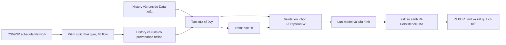

# Hiểu phần ML mà không cần đọc hết code

ML có một việc chính: **nhìn nhu cầu lưu lượng đã xảy ra, dự báo nhu cầu của 48 nhóm flow trong vài giây tới**. Đầu ra là `requested_mbps` dự báo; ML không chọn đường, không cài rule switch và không đo goodput thay Network.

Bạn chỉ cần bắt đầu từ ba chỗ: `ml/README.md` để chạy lệnh, `configs/ml/training.yaml` để xem các cấu hình được thử và `evaluation/REPORT.md` trong thư mục kết quả để đọc kết quả. Các file còn lại chia công việc cho dễ kiểm tra và bảo trì; không phải mỗi file là một chương trình phải chạy tay.

## 1. Hai luồng khác nhau

### Luồng A: học mô hình, chạy offline

`history.csv` và `runs.json` thuộc luồng này khi chuẩn bị bộ dữ liệu offline mới hoặc huấn luyện/đánh giá lại. Chúng không cần cho inference với model đã khóa; không yêu cầu Data xuất thêm hai file trước khi chạy luồng online ở dưới.



1. **Đọc và kiểm dữ liệu.** Phải có đủ 48 flow mỗi giây, demand hữu hạn và không âm. Thiếu dữ liệu thì báo lỗi; không điền 0 để giả thành đầy đủ.
2. **Chia tập trước khi tạo cửa sổ.** Seed 1–10 để học; 11–15 để chọn cấu hình; 16–20 để đánh giá cuối: 10/5/5, tương ứng 50/25/25. Đây là allocation trong manifest Network hiện tại. Cùng seed/family/schedule không được lọt sang split khác.
3. **Tạo mẫu X/y.** X là lịch sử của một flow ở một thời điểm; y là nhu cầu thật trong các giây kế tiếp. Mẫu không nối hai run hoặc hai flow.
4. **Học và chọn bằng validation.** RF học từ train; L/H/epsilon và W của Moving Average được chọn từ validation. Test chưa được đọc ở bước này.
5. **Đóng băng model/config.** Lưu model đã học và các tham số đã chọn. Không học lại bằng train+validation trong pipeline hiện tại.
6. **Đánh giá test một lần cho cấu hình đã chọn.** So sánh ba phương án trên cùng tập mẫu/horizon, xuất sai số và latency. Không đổi mô hình theo kết quả test.

Schedule là lịch phát được sinh sẵn, có thể dùng để học offline. Nó không chứng minh đã phát/nhận thành công trên mạng. Khi import schedule, các mốc UTC 01/01/2000 chỉ là hệ tọa độ giả định để tính offset, không phải thời gian chạy thật. File output luôn giữ dấu nguồn offline này.

### Luồng B: dự báo trong lúc hệ thống đang chạy

```mermaid
flowchart LR
    A["Network công bố demand đã kết thúc bin"] --> B["SDN tạo snapshot"]
    B --> C["Data lưu và cấp lại snapshot"]
    C --> D["ML kiểm snapshot + nạp model đã học"]
    D --> E["Dự báo H bước × 48 flow"]
    E --> F["Áp epsilon một lần"]
    F --> G["Data nhận 48×H hàng, mỗi hàng 7 trường"]
    G --> H["Optimization tính mean H và chọn đường"]
    H --> I["SDN cài và xác minh đường"]
```



Ở luồng này **không train lại mỗi giây**. Runner tạo một `Predictor` để nạp model một lần và gọi `predict_batch` mỗi tick. Nếu snapshot thiếu, stale, có dữ liệu tương lai, hash sai hoặc route chưa verified, ML từ chối và ghi lý do. Chỉ khi history hợp lệ nhưng RF lỗi, policy cho phép mới fallback toàn batch sang Persistence.

Main hiện chưa có controller/Data runtime đầy đủ. API `Predictor` và file contract của ML đã có thể kiểm thử độc lập; sơ đồ trên còn cần tích hợp với producer/consumer thật. Không lấy CSV schedule làm snapshot rồi gọi đó là online.

## 2. L, H, W và epsilon nghĩa là gì?

| Ký hiệu | Cách hiểu | Ví dụ |
|---|---|---|
| L | Số giây lịch sử nhìn lại | L=30: đọc 30 giây đã hoàn tất |
| H | Số giây tương lai cần dự báo | H=5: mỗi flow có 5 dự báo |
| W | Số giây được lấy trung bình cho baseline MA | W=10: lấy trung bình 10 giây cuối trong L |
| epsilon | Tỷ lệ tăng dự báo RF, chọn bằng validation | Raw=4, epsilon=0.1 → final=4.4 Mbps |

Ví dụ warm-up 60s, cutoff `t=100` tính từ lúc measurement bắt đầu, L=30, H=5:

- X là các bin measurement **70–99**, tương ứng schedule offset **130–159**.
- y/dự báo là các bin measurement **100–104**, tương ứng schedule offset **160–164**.
- Có **48×5=240 hàng** gửi Data. Không gửi một giá trị trung bình duy nhất.
- Trong file bundle, X xếp cũ → mới; `features.py` đổi thành `lag_1` mới nhất, rồi lag_2… để model dùng nhất quán ở train và predict.

## 3. Ba mô hình làm gì?

| Mô hình | Cách dự báo | Vai trò |
|---|---|---|
| Persistence | Lặp nhu cầu của giây vừa hoàn tất | Mốc so sánh đơn giản và fallback |
| Moving Average | Lặp trung bình W giây gần nhất | Mốc so sánh có làm mượt |
| Random Forest | Nhiều cây học quan hệ giữa lịch sử và vector tương lai | Mô hình ML chính, dùng chung cho 48 flow |

RF nhận lag, mean/std/min/max/trend của quá khứ và mã flow dạng one-hot. Không dùng seed, scenario, schedule ID hay label tương lai làm feature. RF có thể thua baseline; báo cáo ghi kết quả thực thay vì mặc định coi RF tốt hơn.

## 4. Các file mã nguồn có vai trò gì?

| File | Làm gì | Thường cần mở khi nào? |
|---|---|---|
| `ml/__main__.py` | Cổng lệnh `python -m ml`; nối các bước | Muốn xem một lệnh gọi các bước nào |
| `configs/ml/training.yaml` | Danh sách L/H/epsilon/W, cấu hình cây, seed và giới hạn mẫu train | Muốn thay phạm vi tìm kiếm trước khi đánh giá test |
| `configs/ml/pilot.yaml` | Lượt thử nhẹ hơn: 5.000 mẫu train, 40 cây, vẫn tìm đủ L/H | Chạy trên máy cá nhân trước khi tìm kiếm rộng |
| `ml/preprocessing/schedule.py` | Đọc CSV/ZIP Network, kiểm split/coverage, chuyển sang input offline | Đầu vào còn là schedule Network |
| `ml/preprocessing/bundle.py` | Kiểm history/run manifest, chia cửa sổ X/y, lưu/đọc TrainingBundle và hash | Data bàn giao dữ liệu hoặc gặp lỗi dữ liệu |
| `ml/preprocessing/features.py` | Tạo feature giống nhau khi train và predict | Muốn hiểu model thực sự nhìn thấy gì |
| `ml/baselines/persistence.py` | Dự báo bằng giá trị cuối | Kiểm baseline/fallback |
| `ml/baselines/moving_average.py` | Dự báo bằng trung bình W bin | Kiểm baseline MA |
| `ml/training/train.py` | Học RF, tìm cấu hình bằng validation, lưu artifact | Muốn hiểu việc học/chọn tham số |
| `ml/validation/metrics.py` | MAE/RMSE, bias, underprediction, áp/chọn epsilon | Muốn hiểu các con số đánh giá |
| `ml/validation/evaluate.py` | Đánh giá test, chia kết quả theo scenario/run/flow/horizon, tạo báo cáo | Muốn xem kết quả tốt/xấu ở đâu |
| `ml/model_registry.py` | Kiểm hash, phiên bản thư viện, feature order trước khi nạp model | Nạp model thất bại hoặc đổi môi trường |
| `ml/inference/predict.py` | Kiểm snapshot, dự báo 48 flow, timeout/fallback, xuất 7 trường | Tích hợp ML với Data/Runner |
| `ml/common.py` | Các hàm dùng chung: UTC, hash, kiểm split, đọc/ghi JSON | Tìm quy tắc dữ liệu được dùng ở nhiều bước |
| `ml/demo.py` | Tạo dữ liệu/snapshot giả để thử pipeline | Chạy thử khi chưa có dữ liệu; không dùng làm benchmark |
| `ml/tests/test_pipeline.py` | Kiểm window, leakage, model, epsilon, inference và lỗi đầu vào | Chạy kiểm thử ML |
| `ml/tests/test_schedule.py` | Kiểm import Network và lệnh offline từ đầu đến cuối | Đảm bảo không sửa nhãn hoặc nuốt dữ liệu thiếu |
| `ml/tests/test_cli.py` | Kiểm lỗi CLI, đặc biệt không xuất dự báo giả khi thất bại | Kiểm giao diện lệnh |
| `ml/requirements.txt` | Thư viện chạy ML | Cài môi trường |
| `ml/requirements-dev.txt` | Thêm pytest cho kiểm thử | Cài môi trường phát triển/test |
| `ml/.gitignore` | Không đưa cache/model lớn/kết quả sinh vào Git | Quản lý artifact |
| Các file `__init__.py` | Đánh dấu/thực hiện import package Python | Thường không cần mở |
| Các file `.gitkeep` | Giữ thư mục rỗng trong Git | Không chạy, không ảnh hưởng thuật toán |

## 5. File đầu ra: nên đọc gì trước?

Khi chạy `from-schedule --out ml/artifacts/ten-lan-chay`, bốn thư mục được sinh:

| Thư mục/file | Ý nghĩa |
|---|---|
| `input/history.csv` | Demand từng run/flow/giây đã chuyển từ CSV Network |
| `input/runs.json` | Schedule/seed/split/family và các mốc thời gian offline |
| `input/import_report.json` | Số dòng/lịch, hash nguồn, giả định thời gian và provenance |
| `bundle/bundle.json` | Mục lục bundle, split, số mẫu, hash và nguồn dữ liệu |
| `bundle/train.npz`, `validation.npz`, `test.npz` | Các ma trận X và y; không cần mở bằng trình soạn thảo |
| `bundle/train.csv`, `validation.csv`, `test.csv` | Metadata cho từng sample_id để biết thuộc run/flow/cutoff nào |
| `model/model.joblib` | RF đã học; chương trình nạp, không đọc như văn bản |
| `model/ml_config.json` | L/H/epsilon/W, feature order và tham số RF đã chọn |
| `model/metadata.json` | Hash model/config, phiên bản thư viện, số mẫu học và provenance |
| `model/validation.json` | Kết quả các cấu hình được thử và so sánh baseline trên validation |
| `model/requirements-lock.txt` | Phiên bản thư viện cụ thể của lần train |
| `model/MODEL_CARD.md` | Mô tả ngắn model, target, feature và giới hạn |
| **`evaluation/REPORT.md`** | **Đọc đầu tiên: bảng so sánh, cấu hình, kết quả scenario/horizon** |
| `evaluation/evaluation.json` | Kết quả chi tiết để Testing/mã khác đọc, cả theo run và flow |
| `evaluation/predictions.npz` | Nhãn thật và dự báo của ba phương án để tính lại metric |
| `evaluation/sample_metadata.csv` | Tra cứu sample_id của dự báo test |

`ml/artifacts/` là kết quả được sinh, không phải code cần sửa. `ml/saved_models/` là thư mục dự phòng của repo; lệnh train hiện lưu model ở đường dẫn `--out` bạn chọn. Không cần chép qua đó mới dùng được.

## 6. Những lệnh cần nhớ

Chạy tại thư mục gốc repo:

```powershell
python -m pip install -r ml/requirements-dev.txt
python -m pytest ml/tests -q
python -m ml demo --out ml/artifacts/demo-moi
```

Chạy trên schedule Network, split 10/5/5, với giả định offline 60s warm-up + 360s measurement:

```powershell
python -m ml from-schedule --schedule "network/traffic_schedules/demand_plan.zip" --warmup-seconds 60 --measurement-seconds 360 --config configs/ml/pilot.yaml --out ml/artifacts/network-moi
```

Có Data export hợp lệ thì dùng:

```powershell
python -m ml run --history data/exports/history.csv --runs data/exports/runs.json --out ml/artifacts/data-moi
```

Luôn dùng thư mục output mới; pipeline từ chối ghi đè kết quả cũ. `--stride 5` mặc định lấy một cutoff mỗi 5 giây để học; các bin lịch sử và target vẫn dài **1 giây**. Giới hạn mặc định 50.000 mẫu train được chọn có seed cố định, không phải cắt bỏ test/validation.

Lệnh schedule trên dùng profile pilot chỉ học 5.000 mẫu và 40 cây để giảm chi phí. Đổi sang `--config configs/ml/training.yaml` để tìm kiếm rộng hơn. Báo cáo/metadata luôn ghi số mẫu thực sự dùng, không coi model pilot là đã chứng minh hiệu quả mạng.

## 7. Bàn giao cho Data/Runner

ML bàn giao thư mục `model/` và [DATA_CONTRACT.md](DATA_CONTRACT.md). Data cần trả snapshot đúng hợp đồng đã thống nhất; Runner cấp context có hash model/config, measurement origin, timeout/fallback policy. Cách dùng:

```python
from ml.common import ContractError
from ml.inference.predict import Predictor

predictor = Predictor("ml/artifacts/network-2026-11-18/model")

# snapshot: SDN tạo, Data cung cấp. context: Runner cung cấp.
try:
    rows = predictor.predict_batch(snapshot, context)
except ContractError:
    audit = predictor.last_audit  # Runner ghi lý do, bỏ qua tick.
else:
    audit = predictor.last_audit  # Lưu riêng, không trộn vào rows.
    # Data.commit_prediction_rows(rows) khi adapter Data đã được nối.
```

Rows chỉ có `run_id`, `flow_group_id`, `issued_at`, `forecast_start`, `forecast_end`, `predicted_mbps`, `source`. Data giữ và kiểm đủ rows; Optimization tự tính mean H. Snapshot/hash/transport của controller feature còn phải đối chiếu khi tích hợp; ML hiện không tự sửa snapshot để ép hợp lệ.
